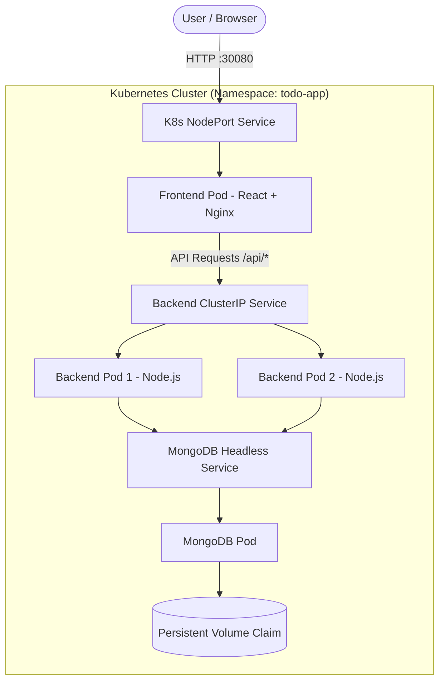

# 🚀 DevOps Todo App — Full-Stack Educational Guide

Welcome to the **DevOps Todo App**! This project is a complete, production-ready Full-Stack application designed to teach **Modern DevOps Practices**. 

It demonstrates how to build, containerize, orchestrate, and automate the deployment of a React + Express + MongoDB application.

---

## 📚 What You Will Learn

This project is a living tutorial. By exploring the codebase and reading this guide, you will learn:
- **Docker**: Multi-stage builds, non-root users, Docker Compose orchestration.
- **Kubernetes**: Deployments, Services (NodePort, ClusterIP, Headless), ConfigMaps, PVCs, Health Probes, and Namespaces.
- **CI/CD Pipeline**: GitHub Actions for automated testing, building, and deployment.
- **Architecture Setup**: Nginx reverse proxies, structured backend patterns (MVC).

---

## 🏗️ Architecture Overview



---

## 📁 Folder Structure Explained

Here's how the project is organized and *why*.

### 1. The Backend (`/backend`)
A professional REST API built with Express.js.
- **`src/config/index.js`**: Centralized config. Reads environment variables in one place.
- **`src/controllers/todoController.js`**: Business logic. Separates "what happens" from "how the route is defined".
- **`src/middleware/`**: Interceptors. `errorHandler.js` formats errors; `logger.js` tracks requests.
- **`src/routes/health.js`**: Kubernetes needs to know if the app is alive. These endpoints answer K8s probes.
- **`Dockerfile`**: Uses a **Multi-Stage Build**. It first installs dependencies, then copies only what's needed to a fresh image, running as a secure, non-root user.

### 2. The Frontend (`/client`)
A React application built with Vite.
- **`nginx.conf`**: Nginx serves the static React files and acts as a **Reverse Proxy**. It catches requests starting with `/api` and forwards them to the backend, bypassing CORS issues.
- **`Dockerfile`**: A multi-stage build that builds the React static files, then copies them into an Nginx image.

### 3. Kubernetes Manifests (`/k8s/base`)
These YAML files tell Kubernetes what to run.
- **`namespace.yaml`**: Isolates our app from other apps in the cluster.
- **`configmap.yaml`**: Injects environment variables (like DB connection strings) into our pods without hardcoding them in Docker images.
- **`mongodb-pvc.yaml`**: Pods are ephemeral (they die). A PVC (Persistent Volume Claim) ensures database data survives restarts.
- **`backend-deployment.yaml`**: Deploys our API. Contains **Liveness Probes** (restarts frozen apps) and **Readiness Probes** (stops traffic if DB disconnects). Defines a **ClusterIP** service (internal access only).
- **`frontend-deployment.yaml`**: Deploys the UI. Defines a **NodePort** service (exposes the app to the outside world).

### 4. CI/CD (`.github/workflows`)
Automation scripts using GitHub Actions.
- **`ci.yml`**: Runs tests and linters every time code is pushed.
- **`docker-compose-test.yml`**: Boots up the entire stack locally in CI to verify it works before merging.
- **`cd-docker.yml`**: Builds Docker images and pushes them to Docker Hub.
- **`deploy-k8s.yml`**: Updates the Kubernetes cluster with the latest images.

---

## 🚀 Getting Started

You can run this project in three different ways: Locally, with Docker, or with Kubernetes.

### Method 1: Local Development (No Docker)
Best for writing code. You must have MongoDB running locally.
1. **Backend**: 
   ```bash
   cd backend
   cp .env.example .env
   npm install
   npm run dev
   ```
2. **Frontend**: 
   ```bash
   cd client
   npm install
   npm run dev
   ```

### Method 2: Docker Compose
Best for testing the full stack easily.
1. Run: `docker-compose up --build -d`
2. App is available at `http://localhost:3000`
3. Stop: `docker-compose down -v`

### Method 3: Kubernetes
Best for production-like environments.
We have provided a handy `Makefile` to simplify operations!
1. Start your local cluster (Minikube or Docker Desktop).
2. Run: `make deploy`
3. Access: `http://localhost:30080` (or run `minikube service frontend -n todo-app --url` if using Minikube).

---

## 🛠️ The Makefile Shortcuts

Instead of typing long commands, use the included Makefile:
- `make up`: Start everything with Docker Compose.
- `make down-clean`: Stop Compose and wipe databases.
- `make deploy`: Deploy all manifests to Kubernetes in the correct order.
- `make k8s-status`: Check if pods are running.
- `make clean`: Nuke all local Docker containers and images.

---

## 🔐 Environment Variables

| Variable | Location | Purpose |
|----------|----------|---------|
| `MONGO_URI` | Backend | Connection string to MongoDB |
| `PORT` | Backend | Port the Express server listens on |
| `NODE_ENV` | Backend | `development` or `production` |
| `DOCKER_HUB_USERNAME` | Root `.env` | Used by CI/CD scripts to tag images |

*(Check `.env.example` in the root and backend folders).*

---

## 📝 License
This project is licensed under the MIT License - see the LICENSE file for details.

## 👨‍💻 Authors
- saurabh singh rajput
